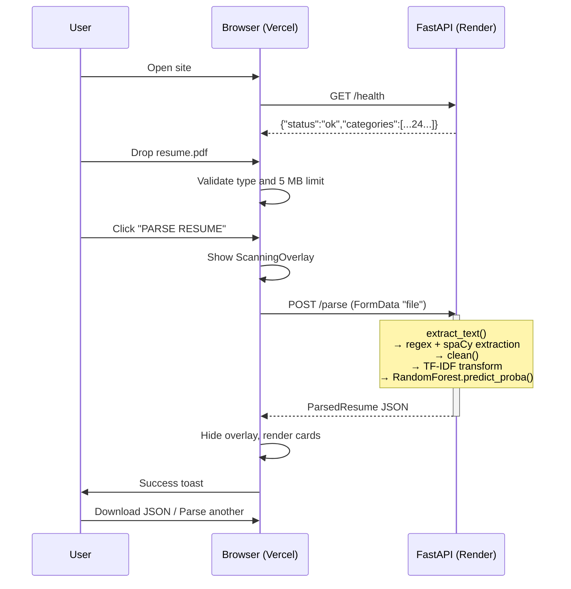

# AI Resume Parser — Project Report

**A full-stack, AI-powered resume parsing web application**

| | |
|---|---|
| **Project type** | College mini project |
| **Repository** | https://github.com/RohiiitttPimpale/ai_resume_parser |
| **Backend (live)** | https://ai-resume-parser-mtke.onrender.com |
| **Frontend** | React 19 + TanStack Start, deployed on Vercel |
| **Stack** | FastAPI · spaCy · scikit-learn · React · TypeScript · TailwindCSS |

---

## Table of Contents

1. [Project Overview](#1-project-overview)
2. [What It Does](#2-what-it-does)
3. [Technology Stack](#3-technology-stack)
4. [Repository Structure](#4-repository-structure)
5. [System Architecture](#5-system-architecture)
6. [Backend — API Contract](#6-backend--api-contract)
7. [Backend — Resume Parsing Pipeline](#7-backend--resume-parsing-pipeline)
8. [Machine Learning Pipeline](#8-machine-learning-pipeline)
9. [Model Results](#9-model-results)
10. [Frontend Architecture](#10-frontend-architecture)
11. [End-to-End Working Flow](#11-end-to-end-working-flow)
12. [Deployment Flow](#12-deployment-flow)
13. [Local Development Setup](#13-local-development-setup)
14. [Limitations & Known Issues](#14-limitations--known-issues)
15. [Future Improvements](#15-future-improvements)

---

## 1. Project Overview

The **AI Resume Parser** accepts a resume in PDF or DOCX format and returns structured,
machine-readable data about the candidate together with a predicted job category.

The project demonstrates two distinct AI/NLP branches working together:

- **Branch 1 — Rule-based + Statistical NLP:** Regular expressions and spaCy's
  `PhraseMatcher` extract the candidate's name, email, phone, skills, education and work
  experience. This is deterministic and explainable.
- **Branch 2 — Supervised Machine Learning:** A TF-IDF vectorizer plus a trained classifier
  predict the candidate's job category across 24 professional domains, with a confidence score.

The application is split into two independently deployed services:

- A Python **FastAPI** backend that performs all parsing and inference.
- A **React** single-page frontend that provides the upload interface and result visualisation.

The browser communicates with the backend **directly**. The frontend host serves only static
assets and the server-rendered shell; it never proxies API traffic.

---

## 2. What It Does

**Input:** one resume file (`.pdf` or `.docx`, maximum 5 MB).

**Output:** a JSON object containing the parsed candidate profile and the predicted category.

```json
{
  "name": "Rohit Pimpale",
  "email": "pimpalerohit26@gmail.com",
  "phone": "1010101010",
  "skills": ["C++", "Docker", "Flask", "Git", "Java", "Linux", "Machine Learning", "Python", "React", "SQL", "TypeScript"],
  "experience": [],
  "education": [
    {
      "degree": "Bachelor of Engineering in Computer Engineering, CGPA: 10/10",
      "institute": "Smt. Indira Gandhi College of Engineering",
      "year": "2024 – 2028"
    }
  ],
  "jobCategory": "ENGINEERING",
  "confidence": 37.3
}
```

*Note: the sample output above is illustrative. Personal details are anonymized to match the
values used in the project README.*

The frontend renders this as cards: a profile card, an animated confidence gauge for the job
category, skill chips, an education list, an experience timeline, and a raw JSON inspector
with a download button.

---

## 3. Technology Stack

### Frontend

| Concern | Technology |
|---|---|
| Framework | React 19 |
| Language | TypeScript |
| Build tool | Vite 8 |
| SSR / meta-framework | TanStack Start |
| Routing | TanStack Router |
| Data fetching | TanStack Query |
| Styling | TailwindCSS v4 |
| Components | shadcn/ui + Radix UI primitives |
| Icons | Lucide React |
| Notifications | Sonner |
| Typography | Orbitron (display font) |
| Deployment runtime | Nitro (SSR output for Vercel) |

### Backend

| Concern | Technology |
|---|---|
| API framework | FastAPI |
| ASGI server | Uvicorn |
| PDF text extraction | pdfplumber |
| DOCX text extraction | python-docx |
| NLP | spaCy (`en_core_web_sm`) with `PhraseMatcher` |
| Classic NLP / feature engineering | Regular expressions |
| Machine learning | scikit-learn |
| Model comparison & tuning | `GridSearchCV`, `StratifiedKFold` |
| Unsupervised analysis | KMeans + PCA |
| Serialization | joblib |
| Data handling | pandas, NumPy |
| Visualisation | Matplotlib |

---

## 4. Repository Structure

```text
ai_resume_parser/
│
├── resume-backend/                    # FastAPI + ML backend
│   ├── data/
│   │   └── Resume.csv                 # Training dataset: 2484 resumes, 24 categories
│   ├── model/
│   │   ├── model.pkl                  # Trained classifier (RandomForestClassifier)
│   │   ├── vectorizer.pkl             # Fitted TF-IDF vectorizer
│   │   ├── model_comparison.csv       # Accuracy / Precision / Recall / F1 per model
│   │   ├── class_distribution.png     # Resumes per category (EDA)
│   │   ├── confusion_matrix.png       # Confusion matrix of the best model
│   │   └── kmeans_pca.png             # K-Means clusters visualised with PCA
│   ├── main.py                        # FastAPI application: /health and /parse
│   ├── resume_parser.py               # Text extraction, cleaning, rule/NLP extraction
│   ├── train.py                       # Training, tuning, evaluation, clustering
│   └── requirements.txt               # Python dependencies
│
├── resume-frontend/                   # React + Vite frontend
│   ├── public/                        # Static assets
│   ├── src/
│   │   ├── api/
│   │   │   └── parseResume.ts         # Typed API client (the only network code)
│   │   ├── components/
│   │   │   ├── resume/                # Feature components
│   │   │   │   ├── HeroSection.tsx
│   │   │   │   ├── UploadCard.tsx
│   │   │   │   ├── ScanningOverlay.tsx
│   │   │   │   ├── ResultsGrid.tsx
│   │   │   │   └── cards.tsx
│   │   │   └── ui/                    # shadcn/ui primitives
│   │   ├── hooks/
│   │   ├── lib/
│   │   ├── routes/
│   │   │   ├── __root.tsx             # Root document, fonts, error boundary
│   │   │   └── index.tsx              # The single application page
│   │   ├── router.tsx
│   │   └── styles.css                 # Global theme + visual effects
│   ├── .env                           # Local dev: VITE_API_URL=http://localhost:8000
│   ├── .env.production                # Production: VITE_API_URL=<Render URL>
│   ├── .env.example                   # Template for new developers
│   ├── package.json
│   └── vite.config.ts                 # tanstackStart + nitro + react + tailwind
│
├── requirements.txt                   # Root-level copy of backend dependencies
├── README.md
└── project_report.md                  # This document
```

---

## 5. System Architecture

The application follows a **two-service, direct-browser-to-backend** architecture.

```
┌──────────────────────────────────────────────────────────────────────┐
│                          USER'S BROWSER                              │
│                                                                      │
│   1. Loads the frontend from Vercel                                  │
│   2. Uploads a resume file                                           │
│   3. Sends the file DIRECTLY to the Render backend                   │
└───────────────┬──────────────────────────────────┬───────────────────┘
                │                                  │
       (1) GET the app                   (2) POST /parse  (multipart file)
                │                                  │
                ▼                                  ▼
┌───────────────────────────────┐   ┌──────────────────────────────────┐
│  VERCEL  (frontend host)      │   │  RENDER  (backend host)          │
│                               │   │                                  │
│  • React 19 + TypeScript      │   │  • FastAPI + Uvicorn             │
│  • TanStack Start SSR (Nitro) │   │  • spaCy + regex extraction      │
│  • TailwindCSS v4             │   │  • TF-IDF + Random Forest        │
│  • Static assets + SSR shell  │   │                                  │
│                               │   │  Endpoints:                      │
│  NEVER talks to the backend   │   │    GET  /health                  │
│  on behalf of the user        │   │    POST /parse                   │
└───────────────────────────────┘   └──────────────────────────────────┘
                                                    │
                                          (3) JSON result
                                                    │
                                                    ▼
                                        back to the browser
```

**Key architectural decision:** the frontend host is *not* a proxy. The browser calls Render
directly. This keeps the deployment simple (no serverless functions acting as a middle layer)
but means **CORS must be configured on the backend** to allow the frontend's origin.

### The two settings that connect the services

| Setting | Location | Purpose |
|---|---|---|
| `VITE_API_URL` | Vercel environment variable / `.env.production` | Tells the browser where the backend lives. Vite **inlines** this value into the JavaScript bundle at build time. |
| `allow_origins` | `resume-backend/main.py` → `CORSMiddleware` | Must list the frontend's origin, otherwise the browser blocks the response. |

> **Important:** because `VITE_*` variables are inlined at build time, changing `VITE_API_URL`
> on Vercel requires a **redeploy**. Editing the environment variable alone does not affect an
> already-built bundle.

---

## 6. Backend — API Contract

The API is deliberately small: two endpoints.

### `GET /health`

Used to check that the service is alive and to list the supported categories.

**Response `200 OK`:**

```json
{
  "status": "ok",
  "categories": ["ACCOUNTANT", "ADVOCATE", "AGRICULTURE", "..."]
}
```

Currently returns **24** categories, derived directly from the loaded model's `classes_`.

### `POST /parse`

Accepts a resume file and returns the parsed result.

- **Content-Type:** `multipart/form-data`
- **Body:** exactly one field named `file`
- **Accepted types:** `.pdf`, `.docx`
- **Maximum size:** 5 MB

**Success `200 OK`:** a `ParsedResume` object (see [Section 2](#2-what-it-does)).

**Error responses** — always `{"detail": "<message>"}`:

| Status | Condition | `detail` message |
|---|---|---|
| `400 Bad Request` | File extension is not `.pdf` or `.docx` | `Only PDF or DOCX files are allowed` |
| `413 Payload Too Large` | File exceeds 5 MB | `File is larger than 5 MB` |
| `422 Unprocessable Entity` | File is corrupted or unreadable | `Could not read this file. It may be corrupted` |
| `422 Unprocessable Entity` | No extractable text (e.g. a scanned image PDF) | `No readable text found. Scanned or image-only resumes are not supported` |

### Request handling order

The endpoint validates in a strict order so that cheap checks short-circuit expensive ones:

```
filename check  →  size check  →  text extraction  →  empty-text check  →  parsing + inference
```

---

## 7. Backend — Resume Parsing Pipeline

The parsing logic lives in `resume_parser.py` and is entirely **rule-based plus statistical NLP**.
No machine learning is involved in extraction; the model is used only for category prediction.

### 7.1 Text extraction

| Format | Library | Method |
|---|---|---|
| PDF | pdfplumber | `page.extract_text()` for every page, joined by newlines |
| DOCX | python-docx | `paragraph.text` for every paragraph, joined by newlines |

### 7.2 Text cleaning — `clean()`

A single shared function, used by **both** training and inference. This is critical: if the two
ever diverge, model accuracy collapses silently.

```python
def clean(text: str) -> str:
    text = re.sub(r"http\S+|\S+@\S+", " ", text)   # strip URLs and emails
    text = re.sub(r"[^a-zA-Z ]", " ", text).lower() # keep letters only, lowercase
    return re.sub(r"\s+", " ", text).strip()        # collapse whitespace
```

### 7.3 Candidate name extraction

Three-tier fallback strategy:

1. **Clean line heuristic** — scan the first 5 non-empty lines. Accept a line with 2–4
   alphabetic words that contains no email or phone and no boilerplate keyword
   (`resume`, `cv`, `biodata`, `profile`, `portfolio`, `contact`, `page`, etc.).
2. **spaCy `PERSON` entity** — look for a `PERSON` entity within the first 300 characters,
   filtered by the same boilerplate rules.
3. **Fallback** — use the first line of the document.

### 7.4 Contact details

- **Email** — regex: `[a-zA-Z0-9_.+-]+@[a-zA-Z0-9-]+\.[a-zA-Z0-9-.]+`
- **Phone** — regex tolerant of country codes, parentheses, dots, spaces and hyphens; supports
  10–13 digit numbers.

### 7.5 Skill extraction

A spaCy `PhraseMatcher` with `attr="LOWER"` (case-insensitive) matches against a curated list
of approximately 110 skills grouped into five families:

| Family | Examples |
|---|---|
| Programming languages | Python, Java, C++, C#, JavaScript, TypeScript, Go, Rust, SQL, HTML, CSS |
| Frameworks & libraries | React, Next.js, Angular, Node.js, FastAPI, Flask, Django, Spring |
| AI / ML / Data science | Machine Learning, Deep Learning, NLP, PyTorch, TensorFlow, Pandas, Power BI |
| Databases / Cloud / DevOps | MongoDB, PostgreSQL, MySQL, Docker, Kubernetes, AWS, Git, Linux, CI/CD |
| Fundamentals & soft skills | Data Structures, Algorithms, DBMS, OOP, REST API, Communication, Leadership |

A `DISPLAY_SKILL_MAP` dictionary then restores proper casing for display, since matching is
case-insensitive:

```
"sql"        → "SQL"          "c++"        → "C++"
"typescript" → "TypeScript"   "next.js"    → "Next.js"
"aws"        → "AWS"          "scikit-learn" → "Scikit-Learn"
```

Everything else is title-cased.

### 7.6 Section-aware education and experience parsing

This is the most intricate part of the parser and the part that was most heavily refined during
development.

The parser walks the document **line by line**, maintaining a `current_section` state derived
from recognised section headers (matched only when the header line is under 40 characters):

| Section | Recognised headers |
|---|---|
| `education` | education, academics, academic background, qualifications |
| `experience` | experience, work experience, employment history, internships, work history |
| `projects` | projects, academic projects, personal projects, technical projects |
| `skills` | skills, technical skills, core competencies, technologies |

**The critical ordering rule — degree detection precedes date detection.**

An early version of the parser checked for a date range *before* checking for a degree. As a
result, a student's line

```
Bachelor of Engineering in Computer Engineering, CGPA: 10/10    2024 – 2028
```

matched the date regex, was classified as **work experience** with an empty company field, and
the education branch was skipped entirely — producing `education: []` and a bogus experience
entry.

The corrected logic now tests `DEGREE.search(line)` **first**. Degree patterns include
B.Tech, B.E, M.Tech, M.E, B.Sc, M.Sc, BCA, MCA, MBA, BBA, Bachelor's, Master's, Diploma,
Ph.D, Higher Secondary, HSC, SSC, CBSE, ICSE, 10th and 12th.

```
for each line:
    if line is a section header (< 40 chars):
        current_section = that header;  continue

    elif line contains a DEGREE keyword:            ← checked FIRST
        duration  = matched date range, or the last year on the line
        deg_text  = line with the date removed
        institute = next line if it looks like an institution
                    else split the current line on at / from / – / -
        education.append({degree, institute, year})

    elif current_section == "experience" or line has a date range:
        duration = matched date range
        role / company = split on " at ", " - ", " | " or ","
                         else company = next line if it isn't a date or header
        experience.append({role, company, duration}) if role is valid
```

**Institute detection** uses a keyword regex — `college`, `university`, `institute`, `school`,
`academy`, `polytechnic`, `vidyalaya`, `campus`, `iit`, `nit`, `iiit`, `bits`. The institute is
taken from the following line when it matches and is neither a degree nor a section header;
otherwise it is split from the same line.

**Guard rails:** education is capped at 4 entries, experience at 5. Lines whose role text
contains `project`, `skills` or `summary` are discarded to avoid capturing section headers or
project names as job titles.

### 7.7 Complete parsing flowchart

```
                    ┌─────────────────────────────┐
                    │  POST /parse                │
                    │  (file bytes + filename)    │
                    └──────────────┬──────────────┘
                                   │
                    ┌──────────────▼──────────────┐
                    │  Extension is .pdf/.docx?   │
                    └──────┬───────────────┬──────┘
                        no │               │ yes
                           ▼               ▼
                   ┌──────────────┐  ┌────────────────────────┐
                   │ 400 Bad      │  │  Size <= 5 MB?         │
                   │ Request      │  └────┬──────────────┬────┘
                   └──────────────┘    no │              │ yes
                                         ▼              ▼
                              ┌──────────────┐  ┌──────────────────────────┐
                              │ 413 Too      │  │  extract_text()          │
                              │ Large        │  │  pdfplumber | python-docx│
                              └──────────────┘  └────┬───────────────┬─────┘
                                                  fail│               │ ok
                                                     ▼               ▼
                                          ┌──────────────┐  ┌──────────────────┐
                                          │ 422 Corrupted│  │ text is empty?   │
                                          └──────────────┘  └───┬──────────┬───┘
                                                            yes │          │ no
                                                                ▼          ▼
                                                    ┌──────────────────┐  ┌────────────────────────┐
                                                    │ 422 No readable  │  │  BRANCH 1: extract_info │
                                                    │ text (scanned)   │  │  ├ name (3-tier)        │
                                                    └──────────────────┘  │  ├ email / phone regex  │
                                                                          │  ├ skills (PhraseMatcher)│
                                                                          │  └ section-aware edu/exp│
                                                                          └───────────┬────────────┘
                                                                                      │
                                                                          ┌───────────▼────────────┐
                                                                          │  BRANCH 2: ML predict  │
                                                                          │  clean(text)           │
                                                                          │  → vectorizer.transform│
                                                                          │  → model.predict_proba │
                                                                          │  → argmax → category   │
                                                                          │  → confidence = max*100│
                                                                          └───────────┬────────────┘
                                                                                      │
                                                                          ┌───────────▼────────────┐
                                                                          │  200 OK  JSON result   │
                                                                          └────────────────────────┘
```

---

## 8. Machine Learning Pipeline

The model is trained by `train.py`, a script written in Jupyter-cell style (`# %%` markers) so
it can run either as a whole file or cell by cell in VS Code.

### 8.1 Dataset

| Property | Value |
|---|---|
| Source | Snehaan Bhawal "Resume Dataset" |
| File | `resume-backend/data/Resume.csv` |
| Columns used | `Resume_str`, `Category` |
| Raw rows | 2484 |
| Categories | 24 |

**Preprocessing steps:**

1. Keep only `Resume_str` and `Category`; drop rows with nulls.
2. Remove duplicate resume texts.
3. Apply `clean()` to every resume.
4. Drop rows whose cleaned text is under 50 characters (near-empty records).

**The 24 categories:**

```
ACCOUNTANT          ADVOCATE            AGRICULTURE         APPAREL
ARTS                AUTOMOBILE          AVIATION            BANKING
BPO                 BUSINESS-DEVELOPMENT CHEF               CONSTRUCTION
CONSULTANT          DESIGNER            DIGITAL-MEDIA       ENGINEERING
FINANCE             FITNESS             HEALTHCARE          HR
INFORMATION-TECHNOLOGY                  PUBLIC-RELATIONS    SALES
TEACHER
```

### 8.2 Exploratory data analysis

A horizontal bar chart of resumes per category is generated and saved to
`model/class_distribution.png`. This confirms the dataset is roughly balanced across the 24
classes, which justifies using **macro-averaged F1** as the primary selection metric — macro
averaging weights every category equally regardless of frequency.

### 8.3 Hyperparameter tuning

A stratified 80/20 train/test split is taken first, and tuning happens **only on the training
portion** to avoid leaking test data.

```python
pipe = Pipeline([
    ("tfidf", TfidfVectorizer(stop_words="english", sublinear_tf=True)),
    ("clf",   LogisticRegression(max_iter=2000)),
])

params = {
    "tfidf__ngram_range":  [(1, 1), (1, 2)],
    "tfidf__max_features": [10000, 20000],
    "clf__C":              [1, 10, 100],
}

GridSearchCV(pipe, params,
             cv=StratifiedKFold(5, shuffle=True, random_state=42),
             scoring="f1_macro")
```

- **`sublinear_tf=True`** applies `1 + log(tf)`, damping the effect of repeated terms.
- **Unigrams + bigrams** and **10 000 features** were selected as the best configuration.
- **Stratified** k-fold keeps the category proportions consistent across folds.

### 8.4 Model comparison

Four candidate models are then trained on the tuned features:

1. **Decision Tree** — a deliberately simple baseline.
2. **Logistic Regression (tuned)** — linear model using the grid-searched `C`.
3. **Random Forest** — 300 estimators, an ensemble of decorrelated trees.
4. **Soft-voting Ensemble** — combines Logistic Regression, Random Forest and a
   calibrated `LinearSVC` (calibrated because `LinearSVC` has no `predict_proba`, and soft
   voting requires probabilities).

Each is evaluated with accuracy, macro precision, macro recall and macro F1, and the results
are written to `model/model_comparison.csv`.

### 8.5 Final model and evaluation

The highest-F1 model is selected, its full classification report is printed, and a confusion
matrix is saved to `model/confusion_matrix.png`.

### 8.6 Unsupervised component

To demonstrate unsupervised learning on the same corpus, the script:

1. Re-vectorizes the cleaned text with a lighter TF-IDF (3000 features, for memory).
2. Runs **KMeans** with `k = 24` (the number of real categories).
3. Computes the **Adjusted Rand Index (ARI)** to measure agreement with the true labels.
4. Reduces to **2 principal components** with **PCA** and reports the variance explained.
5. Plots the clusters in 2D, coloured by KMeans label, to `model/kmeans_pca.png`.
6. Prints a `crosstab` of true category against cluster, to inspect how categories spread.

> *Note:* the ARI value, the PCA variance figure and the crosstab are printed to the console
> during training but are **not persisted to a file**. Re-run `train.py` to reproduce them.

### 8.7 Serialization

```python
joblib.dump(best, "model/model.pkl")        # the winning classifier
joblib.dump(vec,  "model/vectorizer.pkl")   # the fitted TF-IDF vectorizer
```

Both are loaded once at backend startup, in `main.py`:

```python
model      = joblib.load("model/model.pkl")
vectorizer = joblib.load("model/vectorizer.pkl")
```

> Because these are loaded at **import time**, the backend cannot start if either file is
> missing or the spaCy model is unavailable. Any change to the model or vectorizer requires a
> backend restart (or a redeploy on Render).

### 8.8 Inference at request time

```python
proba = model.predict_proba(vectorizer.transform([clean(text)]))[0]
best  = int(proba.argmax())
info["jobCategory"] = str(model.classes_[best])
info["confidence"]  = round(float(proba[best]) * 100, 1)
```

Only the top class and its probability are returned; the full 24-class distribution is
discarded.

---

## 9. Model Results

Measured on the held-out 20% test set. Source: `resume-backend/model/model_comparison.csv`.

| Model | Accuracy | Precision (macro) | Recall (macro) | **F1 (macro)** |
|---|---|---|---|---|
| **Random Forest** | **0.759** | **0.764** | **0.703** | **0.690** |
| Ensemble (LR + RF + SVM) | 0.712 | 0.707 | 0.669 | 0.668 |
| Logistic Regression (tuned) | 0.696 | 0.688 | 0.652 | 0.651 |
| Decision Tree | 0.602 | 0.567 | 0.562 | 0.558 |

### The deployed model

The best-performing model, **Random Forest**, is what was serialized and is currently serving
predictions. Verified from the saved artifact:

| Property | Value |
|---|---|
| Type | `RandomForestClassifier` |
| Estimators | 300 |
| Classes | 24 |
| Vectorizer | `TfidfVectorizer` |
| N-gram range | (1, 2) |
| Max features | 10 000 |
| Vocabulary size | 10 000 terms |

### Interpretation

- **Random Forest winning** shows the categories are not linearly separable in TF-IDF space —
  a nonlinear ensemble beats a linear model by roughly 6 accuracy points and 4 F1 points.
- **The ensemble underperforming the single Random Forest** is expected here. Soft voting is a
  variance-reduction technique, and the ensemble is dragged down by its weakest member. With
  only 4 class-balance-adjacent models and 24 classes, the simpler winner generalises better.
- **Macro F1 (0.690) below accuracy (0.759)** indicates some categories are harder than others.
  The per-class breakdown is in `confusion_matrix.png` and the console classification report.
- **The Decision Tree baseline (0.558 F1)** establishes that the task has real structure worth
  learning — it is well above the ~4% chance level for 24 balanced classes.

---

## 10. Frontend Architecture

The frontend is a **single-page, presentational** application. Visual effects live in the global
theme CSS so the API layer can be swapped without touching the UI.

### 10.1 Page composition

`src/routes/index.tsx` is the entire application page. It holds three pieces of state —
`file`, `scanning`, `result` — and renders exactly one of two views:

- If `result` is null: `UploadCard`
- If `result` is present: `ResultsGrid`

It also renders an animated SVG background (floating "paperwork" symbols and a skyline horizon)
defined inline from `styles.css` CSS custom properties.

### 10.2 The API client — `parseResume.ts`

This file contains **all** network logic in the frontend.

```typescript
const rawBaseUrl = import.meta.env.VITE_API_URL ?? "http://localhost:8000";
const API_URL = rawBaseUrl.replace(/\/+$/, "");
```

- Reads the base URL from `VITE_API_URL`, falling back to the local backend.
- **Strips trailing slashes** so a URL like `https://host/` does not produce `https://host//parse`.
- POSTs `FormData` with the field name `file` to `${API_URL}/parse`.
- On network failure (backend asleep, offline, DNS error) it throws:
  > *"Cannot reach the server. It may be waking up, please try again in a minute."*
- On a non-OK response it reads the `detail` field and throws that message.
- Returns the response typed as `ParsedResume`.

### 10.3 Error handling

Errors surface as **Sonner toasts**. In `index.tsx`:

```typescript
try {
  setResult(await parseResume(file));
  toast.success("Resume parsed successfully!");
} catch (err) {
  toast.error(err instanceof Error ? err.message : "Failed to parse resume");
} finally {
  setScanning(false);
}
```

Because the API client always throws an `Error` with a human-readable message, the UI never
displays a raw exception or a blank failure.

### 10.4 Components

| Component | Responsibility |
|---|---|
| `HeroSection` | Page title and subtitle |
| `UploadCard` | Drag-and-drop zone with click-to-browse; validates file count, extension and 5 MB limit client-side; shows the selected file with a remove button |
| `ScanningOverlay` | Animated overlay shown while a parse is in flight |
| `ResultsGrid` | Lays out all result cards and the action buttons |
| `cards.tsx` | `ProfileCard`, `SkillsCard`, `ExperienceTimeline`, `EducationCard`, `CategoryGauge`, `JsonPanel` |

Notable details:

- **`CategoryGauge`** is an SVG ring whose stroke offset animates from 0 to the confidence
  value using `requestAnimationFrame` with cubic ease-out. It **respects
  `prefers-reduced-motion`** and jumps straight to the final value if the user has reduced
  motion enabled.
- **`EducationCard`** only prefixes `"Class of "` when the year is a bare year — date ranges
  containing `–` or `-` and values containing "present" render as-is, avoiding awkward strings
  like "Class of 2024 – 2028".
- **`ExperienceTimeline`** and **`EducationCard`** both render friendly empty states when there
  is no data, so a student with no work history sees *"No professional experience listed."*
  rather than an empty card.
- **`JsonPanel`** renders syntax-highlighted JSON with a copy-to-clipboard button, and the whole
  result can be downloaded as a `.json` file named after the candidate.

---

## 11. End-to-End Working Flow

### Step-by-step

| # | Actor | Action |
|---|---|---|
| 1 | User | Opens the frontend URL |
| 2 | Browser | Requests the SSR shell and assets from Vercel |
| 3 | Vercel | Serves the React app (Nitro/SSR output) |
| 4 | User | Drags a resume onto the drop zone, or clicks to browse |
| 5 | Browser | Validates: single file, `.pdf`/`.docx`, under 5 MB |
| 6 | User | Clicks **PARSE RESUME** |
| 7 | Browser | Shows `ScanningOverlay`, sets `scanning = true` |
| 8 | Browser | `POST ${VITE_API_URL}/parse` with the file as `FormData` |
| 9 | Backend | Validates extension and size |
| 10 | Backend | Extracts text with pdfplumber or python-docx |
| 11 | Backend | Runs `extract_info()` — name, contacts, skills, education, experience |
| 12 | Backend | Cleans the text and vectorizes it with TF-IDF |
| 13 | Backend | Runs `model.predict_proba`, takes `argmax` → category + confidence |
| 14 | Backend | Returns the JSON result |
| 15 | Browser | Clears the overlay, renders the result cards |
| 16 | Browser | Shows a success toast |
| 17 | User | Inspects the cards, expands the raw JSON, copies or downloads it |
| 18 | User | Clicks **PARSE ANOTHER RESUME** to reset |

### Sequence diagram



### Failure paths

| Failure | Detected by | User sees |
|---|---|---|
| Wrong file type | Client, then server | Inline error, then toast |
| File over 5 MB | Client, then server | Inline error, then toast |
| Scanned / image-only PDF | Server | Toast: *"No readable text found..."* |
| Corrupted file | Server | Toast: *"Could not read this file..."* |
| Backend asleep (Render cold start) | Client fetch failure | Toast: *"Cannot reach the server. It may be waking up..."* |
| CORS misconfigured | Browser | Client fetch failure → same wake-up toast |

---

## 12. Deployment Flow

### 12.1 Complete deployment flowchart

```
┌────────────────────────────────────────────────────────────────────┐
│                       LOCAL DEVELOPMENT MACHINE                    │
│                                                                    │
│   resume-backend/                     resume-frontend/             │
│   ├── parser + model            ───►  ├── npm run dev              │
│   ├── uvicorn main:app                │   → http://localhost:5173  │
│   └── http://127.0.0.1:8000           └── .env: VITE_API_URL=      │
│                                                    localhost:8000  │
└────────────────────────────┬───────────────────────────────────────┘
                             │
                             │  git add . && git commit && git push
                             ▼
┌────────────────────────────────────────────────────────────────────┐
│  GITHUB                                                            │
│  https://github.com/RohiiitttPimpale/ai_resume_parser              │
│  branch: main                                                      │
└──────────┬──────────────────────────────────┬──────────────────────┘
           │                                  │
   auto-deploy on push                auto-deploy on push
           │                                  │
           ▼                                  ▼
┌──────────────────────────────┐  ┌────────────────────────────────────┐
│  RENDER (Backend)            │  │  VERCEL (Frontend)                 │
│                              │  │                                    │
│  Root Dir:  resume-backend   │  │  Root Dir:  resume-frontend        │
│  Build:     pip install -r   │  │  Build:     npm run build          │
│             requirements.txt │  │  Output:    .output  (Nitro)       │
│             + spacy model    │  │  Framework: Vite / Other           │
│  Start:     uvicorn main:app │  │                                    │
│             --host 0.0.0.0   │  │  Env Var:                          │
│             --port $PORT     │  │    VITE_API_URL =                  │
│                              │  │      https://ai-resume-parser-     │
│                              │  │      mtke.onrender.com             │
│                              │  │                                    │
│  URL: https://ai-resume-     │  │  URL: https://<project>.vercel.app │
│       parser-mtke.onrender.  │  │                                    │
│       com                    │  │                                    │
└──────────┬───────────────────┘  └───────────────┬────────────────────┘
           │                                      │
           │  must be listed in                   │
           │  allow_origins  ◄────────────────────┘
           │  (CORS)
           ▼
┌────────────────────────────────────────────────────────────────────┐
│                          USER'S BROWSER                            │
│                                                                    │
│   Loads the app from VERCEL, then uploads a resume STRAIGHT to     │
│   RENDER. The two hosts never talk to each other.                  │
└────────────────────────────────────────────────────────────────────┘
```

### 12.2 One-time deployment order

The order matters because each step produces a value the next step needs.

| Step | Action | Produces |
|---|---|---|
| 1 | Verify `npm run build` passes locally in `resume-frontend` | A deployable `.output/` bundle |
| 2 | Commit and push everything to GitHub | The source Vercel and Render will pull |
| 3 | Create a **Render** Web Service from the repo | The **backend URL** |
| 4 | Test `<backend-url>/health` in a browser | Confirmation that spaCy and the model loaded |
| 5 | Create a **Vercel** project from the repo | The **frontend URL** |
| 6 | Set `VITE_API_URL` on Vercel and redeploy | The frontend now knows where the backend is |
| 7 | Add the Vercel URL to `allow_origins` in `main.py`, then push | CORS unblocked; Render redeploys automatically |

> **Why step 7 must come last:** the Vercel URL does not exist until step 5 completes, and
> CORS must list the exact origin (including scheme and, if applicable, port — no trailing
> slash).

### 12.3 Render configuration (backend)

| Setting | Value |
|---|---|
| Service type | Web Service |
| Root Directory | `resume-backend` |
| Build Command | `pip install -r requirements.txt` (plus downloading the spaCy `en_core_web_sm` model) |
| Start Command | `uvicorn main:app --host 0.0.0.0 --port $PORT` |
| Health check path | `/health` |

Two constraints specific to this project:

1. **Bind to `0.0.0.0`, not `127.0.0.1`.** The `__main__` block in `main.py` uses `127.0.0.1`
   for local development and is **not** used in production; the start command must bind to
   `0.0.0.0` and read the port from `$PORT`.
2. **The spaCy model is an import-time hard dependency.** `resume_parser.py` calls
   `spacy.load("en_core_web_sm")` at module level, so the app cannot start without it. The
   Render build must install it. Installing it as a direct wheel URL in `requirements.txt` makes
   the build self-contained and avoids relying on a separate build step:

   ```
   https://github.com/explosion/spacy-models/releases/download/en_core_web_sm-3.8.0/en_core_web_sm-3.8.0-py3-none-any.whl
   ```

### 12.4 Vercel configuration (frontend)

| Setting | Value |
|---|---|
| Framework Preset | Vite (or Other) |
| **Root Directory** | **`resume-frontend`** — must be set explicitly |
| Build Command | `npm run build` |
| Output Directory | `.output` (produced by Nitro) |
| Environment Variable | `VITE_API_URL` = `https://ai-resume-parser-mtke.onrender.com` (no trailing slash) |

The repository root contains two projects, so Vercel **must** be told to build from
`resume-frontend`. Leaving the root directory at the repository root will fail the build
because there is no `package.json` there.

`vite.config.ts` is configured for Nitro SSR output:

```typescript
export default defineConfig({
  plugins: [
    tanstackStart({ server: { entry: "server" }, /* ... */ }),
    nitro(),
    react(),
    tailwindcss(),
    viteTsconfigPaths(),
  ],
});
```

### 12.5 Environment variables summary

| Variable | Where | Value | When it takes effect |
|---|---|---|---|
| `VITE_API_URL` | Vercel → Environment Variables | `https://ai-resume-parser-mtke.onrender.com` | **Build time** — requires redeploy |
| `VITE_API_URL` | `resume-frontend/.env` | `http://localhost:8000` | Local `npm run dev` |
| `VITE_API_URL` | `resume-frontend/.env.production` | Render URL | `npm run build` (production mode) |

### 12.6 Redeployment

| Trigger | Render | Vercel |
|---|---|---|
| Push to `main` | Rebuilds and restarts automatically | Rebuilds automatically |
| Change an env var | Restart required | **Redeploy required** |
| Change `model.pkl` / `vectorizer.pkl` | Push, then the service restarts and reloads the model | Not affected |

---

## 13. Local Development Setup

### Prerequisites

- Python 3.10 or newer
- Node.js 18 or newer with npm

### Backend

```bash
cd resume-backend

pip install -r requirements.txt
python -m spacy download en_core_web_sm

python main.py
```

The API becomes available at `http://127.0.0.1:8000`. Interactive OpenAPI documentation is at
`http://127.0.0.1:8000/docs`.

### Frontend

```bash
cd resume-frontend

npm install
npm run dev
```

The app becomes available at `http://localhost:5173`.

### Retraining the model (optional)

```bash
cd resume-backend
python train.py
```

This regenerates `model/model.pkl`, `model/vectorizer.pkl`, `model/model_comparison.csv` and the
three PNG figures. The backend must be restarted afterwards to pick up the new artifacts.

### Useful scripts

| Command | Location | Purpose |
|---|---|---|
| `npm run build` | `resume-frontend` | Production build to `.output/` |
| `npm run preview` | `resume-frontend` | Serve the production build locally |
| `npm run lint` | `resume-frontend` | ESLint |
| `npm run format` | `resume-frontend` | Prettier |
| `npm test` | `resume-frontend` | Vitest |

### Environment files

| File | Purpose | Committed? |
|---|---|---|
| `.env` | Local development (`http://localhost:8000`) | Yes |
| `.env.production` | Production build (Render URL) | Yes |
| `.env.example` | Template for new developers | Yes |

`.env.local` and `.env.*.local` are git-ignored.

---

## 14. Limitations & Known Issues

These are deliberate constraints or honest limitations of the current implementation.

### 14.1 No OCR — text-based resumes only

Scanned or image-only PDFs contain no extractable text. The backend detects this and returns a
`422` with the message *"No readable text found. Scanned or image-only resumes are not
supported"* rather than returning empty fields. Adding OCR (Tesseract) would be the single
largest improvement in real-world coverage.

### 14.2 Render free tier cold starts

The backend runs on Render's free plan, which spins an idle instance down. A request after a
period of inactivity can take **over 60 seconds** to complete — confirmed by measurement during
development (a 60-second request timed out; a retry within a ~150-second window succeeded and
returned all 24 categories).

Consequences:

- The first visitor may see the *"It may be waking up"* toast instead of a result.
- The second attempt succeeds.
- Hit `<backend-url>/health` a couple of minutes before a demo to warm the service.
- An external uptime pinger at a 5-minute interval prevents sleeping entirely.

### 14.3 Low absolute confidence scores

The deployed model is a Random Forest over **24 classes**. Random Forests spread probability
mass across the trees, so a *correct* prediction frequently reports only 26–40% top-class
probability. This is mathematically expected, not a bug — but the UI labels it "Confidence
score", which reads as though the model is unsure even when it is right.

Possible improvements: relabel it to make clear it is top-class probability, or display the
top two or three categories with their probabilities.

### 14.4 Resume limits

| Limit | Value |
|---|---|
| Accepted formats | PDF, DOCX |
| Maximum size | 5 MB |
| Language | English only (`en_core_web_sm`) |
| Education entries captured | 4 maximum |
| Experience entries captured | 5 maximum |

### 14.5 Train/test split is by row, not by person

`drop_duplicates(subset="Resume_str")` removes identical resume text, but two resumes derived
from the same person or template could still appear on both sides of the split. The reported
75.9% accuracy is therefore a mildly optimistic estimate. For a mini project this is acceptable;
a person-level or template-level split would be the rigorous approach.

### 14.6 Documentation inconsistency

The root `README.md` describes the classifier as a *"TF-IDF Vectorizer + Multinomial
Classification Model"*. The actual serialized artifact is a **`RandomForestClassifier`** — I
verified this by loading `model.pkl` directly. The README should be corrected.

### 14.7 Duplicate dependency file

`requirements.txt` exists at both the repository root and inside `resume-backend/`. Only the
backend copy is used by the deploy. The root copy is redundant and creates a risk of the two
diverging into different sources of truth.

### 14.8 Import-time hard dependencies

`main.py` loads `model.pkl` and `vectorizer.pkl` at import time, and `resume_parser.py` loads
spaCy's `en_core_web_sm` at import time. A missing or incompatible artifact prevents the service
from starting at all rather than degrading gracefully.

---

## 15. Future Improvements

Ranked roughly by value relative to effort.

| # | Improvement | Benefit |
|---|---|---|
| 1 | **Add OCR** (Tesseract / `pytesseract`) as a fallback when no text is extracted | Enables scanned resumes, the largest real-world gap |
| 2 | **Show top-N categories with probabilities** | Turns a misleading "low confidence" into useful information |
| 3 | **Embed a confusion matrix / metrics table in the UI** | Makes the ML work visible in the demo rather than only in a CSV |
| 4 | **Warm the backend** with an uptime pinger or a paid instance | Removes the cold-start first impression problem |
| 5 | **Person-level train/test split** | Makes the reported accuracy trustworthy |
| 6 | **Add tests for `resume_parser.py`** — a table of input lines to expected `education`/`experience` output | Prevents regressions like the degree/date-ordering bug from returning |
| 7 | **Correct the README's model description** and delete the duplicate root `requirements.txt` | Removes two inaccuracies in the documentation |
| 8 | **Store and surface the training metrics** (classification report, ARI, PCA variance) as JSON | Reproducible reporting without re-running `train.py` |
| 9 | **Multi-language support** via a larger spaCy model | Broadens the user base |
| 10 | **Persist parse history** (database) | Enables analytics and comparison across CVs |

---

## Appendix A — Verification Notes

All figures and claims in this report were verified against the artifacts on disk:

| Claim | How verified |
|---|---|
| 2484 rows, 24 categories | `pandas.read_csv('data/Resume.csv')` → `len(df)`, `df['Category'].nunique()` |
| Model is Random Forest, 300 trees | `joblib.load('model/model.pkl')` → `type`, `n_estimators` |
| Vectorizer: (1,2) n-grams, 10 000 features | `joblib.load('model/vectorizer.pkl')` → `ngram_range`, `max_features`, `len(vocabulary_)` |
| 24 classes in the live model | `len(model.classes_)` and live `GET /health` |
| Performance table | `model/model_comparison.csv` verbatim |
| Live backend reachable, 24 categories | `GET https://ai-resume-parser-mtke.onrender.com/health` → `STATUS: ok, COUNT: 24` |
| Production frontend build passes | `npm run build` output in the deployment log |

Values **not** persisted anywhere and therefore not quoted: the KMeans Adjusted Rand Index, the
PCA cumulative variance explained, and the per-class precision/recall from the classification
report. These are printed to the console when `train.py` runs.

---

*End of report.*
